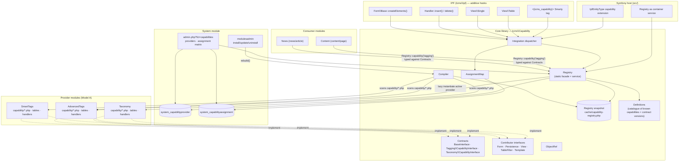
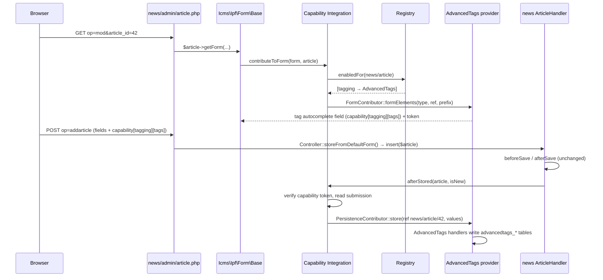
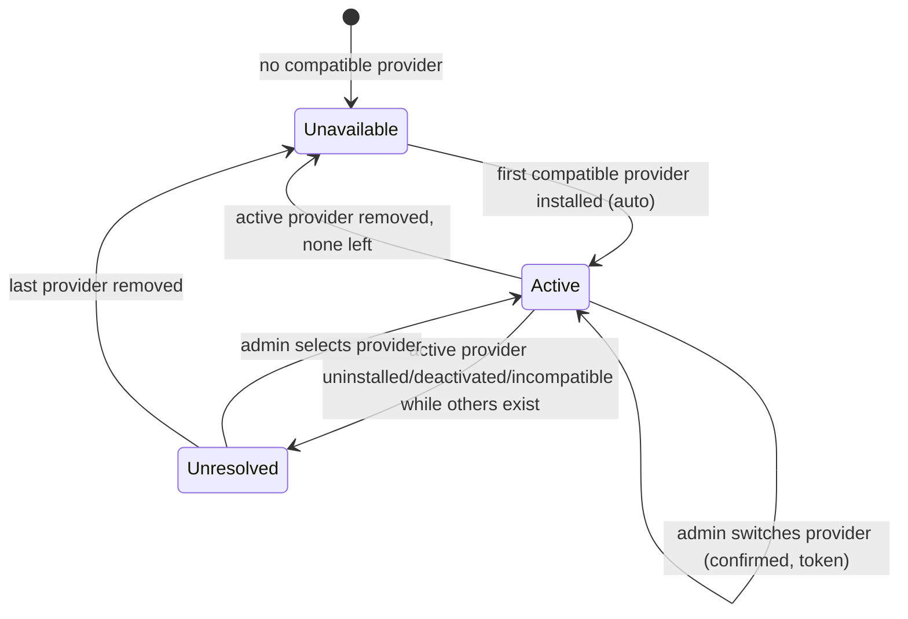

## Context

See `proposal.md` (Why) and the five specs of this change (`capability-registry`, `capability-contracts`, `capability-provider-selection`, `capability-assignment`, `capability-ipf-integration`).

The design depends on these parts of the current code:

- **IPF objects**:
  - `icms_ipf_Object` is an alias of `Icms\Ipf\Entity` (`htdocs/libraries/Icms/aliases.php`).
  - Handlers extend `Icms\Ipf\Handler`. A handler knows its module (`_moduleName`), its item (`_itemname`) and its key (`keyName`).
  - The pair `<module>/<item>` is the natural object type identifier. It is also how modules list their IPF items, in `$modversion['object_items']`.
- **Handler events**: `Icms\Ipf\Handler::insert()` and `delete()` run `executeEvent()` for `beforeSave`, `beforeInsert`/`beforeUpdate`, `afterSave`, `afterInsert`/`afterUpdate`, `beforeDelete` and `afterDelete`. `executeEvent()` only calls methods on the handler itself (or hooks registered by `addEventHook()`). External code cannot subscribe to it, and it does not trigger `Icms\Event`.
- **Forms**:
  - `Icms\Ipf\Form\Base::createElements()` builds the form from `vars` and `controls`, followed by `createPermissionControls()` and `createButtons()`. There is no extension point.
  - `getForm()` renders without a security token. `getSecureForm()` renders with one.
- **Views**: `Icms\Ipf\View\Single` and `Icms\Ipf\View\Table` render generic IPF views. `Table` reads its filters from the request itself and builds a `CriteriaCompo`.
- **Events**:
  - `Icms\Event::trigger()` is the legacy event bus. Preloads subscribe to it.
  - In framework requests, `App\Legacy\LegacyEventForwarder` forwards `icms.*` events to the Symfony dispatcher.
- **Module lifecycle**:
  - `modules/system/admin/modulesadmin/modulesadmin.php` installs, updates and uninstalls modules.
  - Modules can hook in with `onInstall`, `onUpdate` and `onUninstall`.
  - Module metadata comes from `icms_version.php` (`$modversion`).
- **Existing one-off capability**: `Icms\Ipf\Seo\Entity` adds SEO fields by inheritance. This is the pattern this change replaces for new features.
- **Host**:
  - `App\Legacy\HandlerLocator` exposes legacy handlers to the container.
  - `App\Ipf\Form\IpfEntityType` builds Symfony forms from IPF metadata.
  - `App\Ipf\IpfPersister` stores entities through `handler->insert()`.

## Goals / Non-Goals

**Goals:**
- A consumer module never names a provider module. It only depends on contracts in `Icms\Capability\Contract`.
- A consumer module needs **no code** to get capability fields in its IPF edit forms, propagation on save and delete, rows in the generic single view and filters in its admin tables.
- Zero cost for requests that use no capability. Constant overhead for IPF pages of types without enabled capabilities: one in-memory map lookup per form, save and view.
- The same registry, contracts and contributions in legacy requests and in Symfony-handled requests.

**Non-Goals:**
- A dependency injection container for legacy code. The registry is a deliberately small service locator.
- Moving data between providers on a switch. Only the optional contract is designed here (D13).
- Rendering capability output in custom consumer templates without any template change. See D11 and the risks.
- Per-object (instance-level) enablement.

## Architecture overview



Runtime flow for "edit and save article 42" with `tagging` assigned to `news/article` and AdvancedTags active:



## Decisions

### D1. Architecture: a central registry, declarative registration and targeted IPF extension points

Three approaches were evaluated against the criteria the assignment requested. Scores run from ++ (strong) to −− (weak).

| Criterion | 1. Registry Pattern | 2. Service Provider Pattern | 3. Event-Driven Extension Model |
|---|---|---|---|
| Loose coupling | ++ consumers know names and contracts only | + consumers know contracts; providers must know the container | ++ consumers know event names only |
| Extensibility | + new capability = new contract + definition | ++ providers can register anything | ++ anyone can listen |
| Maintainability | ++ one place answers "who provides X, is it on for Y" | − registration logic is spread over provider boot code | −− behaviour emerges from listeners; "one active provider" is hard to enforce and debug |
| Performance | ++ compiled snapshot, lazy instantiation | − every provider's boot code runs on every request, unless deferred providers are built | − dispatch on every form, save and view; every listener must filter itself |
| Ease of implementation | ++ small, no container needed in legacy | − needs a container or provider lifecycle in legacy, which does not exist | + `Icms\Event` exists |
| IPF compatibility | ++ maps to handlers, `object_items` and module lifecycle | + fits the Symfony host; poor in legacy requests | + `Icms\Event` exists; but IPF handler events are not on the bus |
| Data + UI support | + data via contracts; UI needs extension points | + UI via registered services | ++ UI via events; data only via ad-hoc payloads (no typed contract) |

**Pure registry** answers "which provider is active" and "give me the data API" very well. On its own, though, it cannot put UI into consumer forms and views without the consumers' cooperation.

**Pure service providers** (Laravel style: each module has a provider class with `register()`/`boot()`) need a container and a boot phase that legacy requests do not have. Running every provider's boot code on every request also contradicts the "no cost when unused" goal. It does fit the Symfony host, which is why the host bridge (D14) exposes the registry as a service instead of building a second mechanism.

**Pure events** give maximal decoupling, but they work against two hard requirements. "Exactly one active provider" would have to be enforced by every listener checking whether it is the active one. And "consumers depend on a typed contract" is lost, because event payloads are untyped.

**Decision: a hybrid with the registry as the backbone.**
1. A **Registry** (approach 1) owns discovery, selection, assignment and runtime lookup. Typed contracts carry the data.
2. **Registration is by naming convention** (D5), compiled once into a snapshot (D6): the useful part of approach 2 without its boot cost. A provider class in `capability/` is the declaration. The contracts it implements tell the registry what it offers, and the registry instantiates it lazily.
3. **UI and lifecycle integration uses a fixed set of extension points** in IPF (approach 3). The points are dispatched by the registry's integration dispatcher **only to the active providers of capabilities enabled for the object's type**, so they are not broadcast to arbitrary listeners. Framework-level notifications (`providerActivated`, `providerSwitched`, `capabilityUnavailable`) are additionally fired on `Icms\Event`, so preloads and Symfony listeners can observe them. Correctness never depends on them.

### D2. Location: `Icms\Capability` in the core library, plus a thin host bridge

IPF objects live in the core library and are used by legacy requests that never boot Symfony, so the registry, contracts and IPF hooks must live in `htdocs/libraries/Icms/Capability` (namespace `Icms\Capability`).

Legacy aliases follow the existing scheme:
- `icms_capability_Registry` → `Icms\Capability\Registry`
- `icms_capability_ObjectRef` → `Icms\Capability\ObjectRef`

The host only registers the registry as a service and adds the Symfony form extension (D14).

Class names follow the IPF PSR-4 convention (`Icms\Ipf\Entity`, `Icms\Ipf\Handler`, `Icms\Ipf\Form\Base`). The namespace carries the context, and the class name does not repeat it:
- `Contract\Tagging\CapabilityInterface`, not `Contract\Tagging\TaggingCapabilityInterface`
- `State`, `Definitions` and `Exception\UnavailableException` directly under `Icms\Capability`, not `CapabilityState`, `CapabilityDefinitions` or `CapabilityUnavailableException`

The generic base contract is `Contract\BaseInterface`, so that it does not clash with the capability-specific `CapabilityInterface` it is extended by. Consumers that use several contracts in one file import them with an alias (`use Icms\Capability\Contract\Tagging\CapabilityInterface as Tagging;`).

Layout:

```
htdocs/libraries/Icms/Capability/
  Registry.php                     facade + instance (lookup, state, enabledFor)
  RegistrySnapshot.php             immutable compiled data
  Compiler.php                     scans capability/*.php of installed modules → snapshot
  Definitions.php                  catalogue: name → contract interface, version, title
  State.php                        enum: Active, Unresolved, Unavailable
  ObjectRef.php
  AssignmentMap.php                object type → enabled capabilities (from system table)
  Integration.php                  dispatcher used by the IPF hooks
  Submission.php                   capability values of one submitted form
  Exception/UnavailableException.php
  Exception/UnsupportedObjectException.php
  Contract/BaseInterface.php
  Contract/Tagging/CapabilityInterface.php, Tag.php
  Contract/Taxonomy/CapabilityInterface.php, Term.php, Vocabulary.php
  Ui/FormContributorInterface.php
  Ui/PersistenceContributorInterface.php
  Ui/ViewContributorInterface.php
  Ui/TableFilterContributorInterface.php
  Ui/TemplateRendererInterface.php
```

### D3. Contracts: one capability-specific interface per capability on top of a small generic base

The alternative is one generic contract, such as `execute(string $operation, array $args)` or a generic "attach data to object" API. It was rejected:
- it loses static typing and IDE support
- it hides breaking changes, because nothing fails until runtime
- it pushes validation into every provider

Capability-specific interfaces make the contract the documentation, and PHPStan can check consumers.

Generic base, shared by every capability:

```php
namespace Icms\Capability\Contract;

use Icms\Capability\ObjectRef;

interface BaseInterface
{
    public function capabilityName(): string;

    public function contractVersion(): string;

    public function providerModule(): string;

    /** Can this provider serve objects of the given type ("news/article")? */
    public function supportsObjectType(string $objectType): bool;

    /** Remove everything the provider stores for this object. Idempotent. */
    public function clear(ObjectRef $ref): void;

    /** Remove everything the provider stores for objects of this type (the consumer is uninstalled). Idempotent. */
    public function clearType(string $objectType): void;

    /** The provider's own administration page, linked from the capabilities page. */
    public function adminUrl(): ?string;
}
```

Every specific contract has a constant `VERSION`. The provider's `contractVersion()` must be compatible with it (D8).

### D4. `ObjectRef`: the only coupling between providers and consumer objects

Providers store `(module, item, id)` triples, never foreign keys into consumer tables. The triple is enough to:
- rebuild the object through `icms_getModuleHandler($item, $module)->get($id)`, when a provider needs it (for example to link to `getItemLink()`)
- partition data per object type (tag clouds per type)

```php
namespace Icms\Capability;

use Icms\Capability\Exception\UnsupportedObjectException;
use Icms\Ipf\Entity;

final class ObjectRef
{
    public function __construct(
        public readonly string $module,
        public readonly string $item,
        public readonly int $id,
    ) {
    }

    public static function fromEntity(object $entity): self
    {
        if (! $entity instanceof Entity) {
            throw UnsupportedObjectException::forObject($entity);
        }

        $id = (int) $entity->id();

        if ($id === 0) {
            throw UnsupportedObjectException::notStored($entity);
        }

        return new self($entity->handler->_moduleName, $entity->handler->_itemname, $id);
    }

    public function objectType(): string
    {
        return "{$this->module}/{$this->item}";
    }

    public function toString(): string
    {
        return "{$this->module}/{$this->item}/{$this->id}";
    }
}
```

Non-integer keys are not used by IPF handlers in the core. The constructor can later be widened to `int|string` without breaking providers that store `toString()`.

**Resolving references back to objects** goes through the existing per-request IPF object cache, `Icms\Ipf\Registry\Handler`. Providers often need the consumer object behind a reference: the title and link on a tag page, or the objects in a taxonomy browser. Two helpers on `ObjectRef` do this without N+1 queries:

```php
namespace Icms\Capability;

use Icms\Db\Criteria\Item;
use Icms\Ipf\Entity;
use Icms\Ipf\Registry\Handler as ObjectCache;

final class ObjectRef
{
    // ...

    public function resolve(): ?Entity
    {
        return self::resolveMany([$this])[$this->toString()] ?? null;
    }

    /**
     * @param list<ObjectRef> $refs
     * @return array<string, Entity> keyed by ObjectRef::toString(); unresolvable refs are left out
     */
    public static function resolveMany(array $refs): array
    {
        // per object type:
        // 1. skip the type when its module is not installed and active (icms_module_Handler::getActive())
        // 2. ids not yet cached → ObjectCache::getInstance()->addObjectsFromHandler($handler, new Item($handler->keyName, '(' . implode(',', $ids) . ')', 'IN'))
        // 3. read each object with ObjectCache::getInstance()->getSingleObject($item, $id, $module)
    }
}
```

The rules:
- **Load through `addObjectsFromHandler()`, never through the cache's own fallback.** `Registry\Handler::getObjects()` loads *all* objects of the type on a miss, without `id_as_key`. `addObjectsFromHandler()` loads exactly the requested ids, keyed by id, which is what `getSingleObject()` expects.
- **Load each type in one batch.** `addObjectsFromHandler()` replaces the cached set of a type instead of merging into it. `resolveMany()` therefore loads all missing ids of one type in a single call, together with the ids that are already cached.
- **Uninstalled modules resolve to nothing.** The module of the object type is checked first, so `icms_getModuleHandler()` is never called for a module that is gone. A deleted object also resolves to nothing. Providers use that to detect orphaned data (see Risks).

### D5. Provider registration: a naming convention, as for preloads and module classes

A provider registers itself by convention, without a declaration file and without a `$modversion` key. This follows the way ImpressCMS already finds preloads (`preload/<Name>.php` → `IcmsPreload<Name>`) and IPF module classes (`class/<Name>.php` → `mod_<dirname>_<Name>`):

| Element | Convention |
|---|---|
| Location | `modules/<dirname>/capability/<Name>.php`, one file per capability |
| Capability | the file name: `Tagging.php` → `tagging`, `Taxonomy.php` → `taxonomy` (lower-cased, checked against `Definitions`) |
| Class | `mod_<dirname>_<Name>Capability`, for example `mod_advancedtags_TaggingCapability` |
| Contract | the class implements the capability's contract (`Contract\Tagging\CapabilityInterface`) |
| Contract version | `contractVersion()`, from `BaseInterface` |
| UI contributions | detected with `instanceof` on the `Ui\*` contracts. A class contributes only what it implements |
| Object types it can serve | `supportsObjectType()`, from `BaseInterface` |
| Link to its admin page | `adminUrl(): ?string`, from `BaseInterface` (`null` when there is none) |

Example:

```php
<?php
// modules/advancedtags/capability/Tagging.php

use Icms\Capability\Contract\Tagging\CapabilityInterface;
use Icms\Capability\Ui\FormContributorInterface;
use Icms\Capability\Ui\PersistenceContributorInterface;
use Icms\Capability\Ui\TableFilterContributorInterface;
use Icms\Capability\Ui\TemplateRendererInterface;
use Icms\Capability\Ui\ViewContributorInterface;

class mod_advancedtags_TaggingCapability implements
    CapabilityInterface,
    FormContributorInterface,
    PersistenceContributorInterface,
    ViewContributorInterface,
    TableFilterContributorInterface,
    TemplateRendererInterface
{
    // data methods delegate to the module's own IPF handlers (D12)
}
```

The rules:
- **The class is the service and the contributor.** The registry instantiates it once per request, on first use, and uses it both as the contract implementation and as the contributor for every `Ui\*` contract it implements. Data access stays in the provider's own IPF handlers (Model A). The capability class delegates to them, typically through `icms_getModuleHandler('<item>', '<dirname>')`.
- **The constructor takes no arguments and has no side effects.** The compiler instantiates the class once to read `contractVersion()`, and the registry instantiates it lazily at runtime. Handlers are fetched on demand inside the methods, not in the constructor.
- **Files that are not provider classes are ignored**: `index.html` and anything that is not a `.php` file. A `.php` file whose name is not a known capability is reported as an error, so that a typo does not silently disable a provider.
- **Errors are per file.** A file that fails to load, does not declare the expected class, or does not implement the capability's contract rejects only that provider (spec `capability-registry`, "Invalid provider class").

*Alternatives:*
- **A `capabilities.php` manifest that returns an array.** This was the first design. It was rejected because it declares a second time what the class already states: a manifest could claim `tagging` for a class that does not implement the contract, or name a different version. The convention makes "implements the contract" the declaration, so PHPStan checks it. It also removes the manifest format and its validation code.
- **Discovery like preloads, at every request.** Rejected: preloads scan their directory and include every file on every request. The convention is only read by the compiler (D6).
- **Scanning `class/` for classes that implement a contract.** Rejected: it would load every module class at compile time, and a handler that happens to implement a contract would become a provider without its author intending it.

A provider that **defines a new capability** (not in the core catalogue) is not supported in this change. Contracts must live in the core, so that consumers do not depend on a module (spec `capability-contracts`). New capabilities are added to `Definitions` by later core changes (see Future extensibility).

### D6. Compiled snapshot, rebuilt on the module lifecycle

`Compiler::compile()` scans the `capability/` directory of every installed, active module. For each file it:
1. includes it in an isolated scope, inside an error handler that turns warnings, errors and `Throwable`s into a provider error instead of a failed request
2. checks the class name, the implemented contract and the version (D8)
3. records the implemented `Ui\*` contracts

It then writes `ICMS_CACHE_PATH/capability-registry.php`. The file is a `var_export`ed array, written to a temporary file and renamed so the write is atomic. OPcache keeps it in shared memory, so loading it costs about as much as including a constant array.

The compiler is called:
- from `modulesadmin.php` after install, update and uninstall, and after a module is activated or deactivated, through one small call `\Icms\Capability\Registry::rebuild()`
- from the "Rebuild" button on the capabilities page
- lazily at runtime, when the snapshot is missing (first request after deploy or after the cache was cleared)

The snapshot contains, per capability, its providers, each with:
- module, file path and class
- reported contract version and compatibility
- the `Ui\*` contracts it implements
- errors

Per module, it also contains the rejected files and their reasons. It does **not** contain the active selection. That lives in the database (D7), so that an admin change needs no rebuild.

At runtime the registry `require_once`s the file path from the snapshot and instantiates the class. No autoloader and no directory scan is involved. Whether a provider serves a given object type is asked at runtime (`supportsObjectType()`). That only happens when the capability is enabled for the type, and then the provider is used anyway.

*Alternatives:*
- Scanning on every request: rejected for performance.
- Storing the compiled data in the database: rejected, because a file include beats a query, and the cache directory is already the home for derived data.

### D7. Framework configuration: two small IPF-managed system tables

Model A says the framework stores no **capability data**. It still needs two pieces of its own **configuration**, stored in two IPF entities of the system module (IPF persistence, per the constraints):

| Table | Columns | Meaning |
|---|---|---|
| `system_capabilityprovider` | `capabilityproviderid` (PK), `capability`, `provider` (module dirname), `activated` (int, timestamp), `activated_by` (uid) | the active provider per capability (one row per capability) |
| `system_capabilityassignment` | `capabilityassignmentid` (PK), `object_type` (`news/article`), `capability`, `enabled` (0/1), `source` (`admin`/`default`) | the assignment matrix |

*Implementation notes:*
- The keys are integers: the automatic IPF table creation (`Icms\Db\Legacy\Updater\Handler::upgradeObjectItem()`) makes the key column `auto_increment`. The registry keeps one row per capability.
- The entities and handlers are library classes, `Icms\Capability\Config\Provider`/`ProviderHandler` and `Assignment`/`AssignmentHandler`, registered in `aliases.php` under the names `icms_getModuleHandler()` looks for (`mod_system_CapabilityproviderHandler`, …). The system module lists them in `object_items`, so its install and update create the tables. A handler of a system item would otherwise live in `modules/system/admin/<item>/class/`, and every directory under `admin/` is treated as an admin function.
- The capabilities page renders its HTML itself, without a Smarty template, because system templates are only installed by a system module update.

Both tables are read **once per request**, and only when a capability or an IPF hook needs them. Both are tiny: rows = capabilities, and object types × capabilities.

The once-per-request loading uses the existing IPF object cache, `Icms\Ipf\Registry\Handler`, instead of a cache of its own:

```php
$cache = ObjectCache::getInstance();

$providers = $cache->addObjectsFromHandler(icms_getModuleHandler('capabilityprovider', 'system'));
$assignments = $cache->addObjectsFromHandler(icms_getModuleHandler('capabilityassignment', 'system'));
```

The rules:
- `Registry` and `AssignmentMap` load the tables through `addObjectsFromHandler()`, which keys them by id. Later in the request they read them with `getObjects()`, which then hits the cache. They only build their own lookup (`capability → provider`, `objectType → capabilities`) on top of the cached entities.
- After the capabilities page has saved a change, it refreshes the cached set with `addObjectsFromHandler()` before it renders again. The page redirects after a save anyway, so the next request reads fresh data.

*Alternatives:*
- System preferences (`icms_config`) with serialized arrays: rejected. A matrix with per-cell sources and history does not fit config items, and concurrent admin edits would overwrite each other.
- The snapshot file: rejected. Admin decisions must survive a cache wipe.

### D8. Provider selection: a small state machine, nothing automatic beyond the unambiguous case

State per capability, derived at request time from the snapshot and `system_capabilityprovider`:



The rules:
- **Auto-activation**: happens only when the capability has no row in `system_capabilityprovider` and exactly one compatible provider exists. The rebuild writes the row and records `activated_by = 0` (system).
- **A row that points to a provider that is gone or incompatible** is kept, not deleted. The state is then `Unresolved`, and the page explains why. This way an accidental deactivation and reactivation restores the previous selection.
- **No automatic fallback** to another provider: data is not shared between providers (Model A), so a silent switch would make data appear lost.
- **The switch** is done in the capabilities admin with a confirmation screen and the ImpressCMS security token. The confirmation lists the affected object types. The switch fires `Icms\Event::trigger('icms_capability', 'providerSwitched', …)`.
- **Uninstall warning**: `modulesadmin` asks the registry which assigned capabilities the module actively provides, and adds them to its existing confirmation text.
- **Version compatibility**: same major version, and a provider minor version greater than or equal to the core's.

Provider selector UI (system admin, `admin.php?fct=capabilities`, tab "Providers"):

```
Capabilities                                          [Rebuild registry]
──────────────────────────────────────────────────────────────────────────
Tagging   contract 1.0                                state: ● active
  (•) AdvancedTags 1.2   contract 1.0  compatible     [Manage tags →]
  ( ) SmartTags 2.0      contract 1.0  compatible     [Manage tags →]
  ( ) OldTags 0.9        contract 0.3  ✕ incompatible (major 0 ≠ 1)
                                                      [Save selection]
Taxonomy  contract 1.0                                state: ⚠ unresolved
  Active provider "knowledgemanager" was uninstalled on 2026-10-20.
  ( ) Taxonomy 1.0       contract 1.0  compatible
                                                      [Save selection]
Workflow  contract 1.0                                state: ○ unavailable
  No installed module provides this capability.
```

### D9. Assignment granularity: the IPF object type (`<module>/<item>`)

The options considered:

| Level | Verdict |
|---|---|
| **Module** (`news`) | Too coarse. `news/category` rarely wants the same capabilities as `news/article`, and the assignment's own example is per type ("News Article", "Content Page"). |
| **Object type** (`news/article`) | **Chosen.** It matches the admin's mental model and `$modversion['object_items']`, can be derived from any handler, and gives a small matrix. |
| **IPF object definition** (in the entity class, e.g. `$this->enableCapability('tagging')` in `__construct`) | Rejected as the main mechanism, because it requires consumer code changes and takes the decision away from the administrator. It survives in a weaker form: as consumer **declarations** (opt-outs and defaults, below), which the admin matrix respects. |
| **Instance** (per article) | Out of scope. It needs storage per object, and no requirement asks for it. Providers may still offer per-object settings inside their own data. |

Consumer declarations live in `icms_version.php` next to `object_items`:

```php
$modversion['object_items'][1] = 'article';
$modversion['object_items'][2] = 'category';

$modversion['capability_support'] = [
    'article' => ['default' => ['tagging', 'taxonomy']],
    'category' => ['unsupported' => ['workflow', 'tagging']],
];
```

`AssignmentMap::isEnabled(string $objectType, string $capability)` is true only when all of these hold:
- the matrix cell is enabled
- the capability is not `unsupported` for the type
- the capability is `Active`
- the active provider's `supportsObjectType()` accepts the type

The matrix cells come from the `capabilityassignment` objects in the IPF object cache (D7). The map is built from them once per request.

### D10. UI and lifecycle contributors: small interfaces, resolved per object type

Providers implement only what they need:

```php
namespace Icms\Capability\Ui;

use Icms\Capability\ObjectRef;
use Icms\Capability\Submission;
use Icms\Ipf\Form\Base;

interface FormContributorInterface
{
    /**
     * The fields of the section, named under $fieldPrefix; $ref is null for a new object.
     *
     * @return list<\Icms\Form\Element>
     */
    public function formElements(string $objectType, ?ObjectRef $ref, string $fieldPrefix): array;
}

interface PersistenceContributorInterface
{
    /** @return list<string> error messages; empty on success */
    public function store(ObjectRef $ref, Submission $submission): array;
}

interface ViewContributorInterface
{
    /** @param list<ObjectRef> $refs */
    public function prefetch(array $refs): void;

    /** @return array{
        caption: string,
        html: string
    }|null */
    public function viewRow(ObjectRef $ref): ?array;
}

interface TableFilterContributorInterface
{
    /** @return array<string, string> filter value => label, shown in the table's filter select */
    public function filterOptions(string $objectType): array;

    /** @return list<int> the object ids that match */
    public function matchingIds(string $objectType, string $filterValue): array;
}

interface TemplateRendererInterface
{
    /** @param array<string, mixed> $params */
    public function render(ObjectRef $ref, string $variant, array $params): string;
}
```

A form contributor returns its fields instead of adding them to a legacy form, so that the same fields serve the legacy IPF form (`Integration` adds the section heading, the fields and the capability token) and the framework form (D14 adapts them to Symfony fields).

`Icms\Capability\Integration` is the only class the IPF hooks call. Per call, it asks the `AssignmentMap` for the capabilities enabled for the object type. For each of them, it asks the registry for the active provider's contributor of the requested kind, and instantiates it lazily, once per request.

### D11. Where the IPF hooks go (additive, inert)

| Hook | Location | Behaviour |
|---|---|---|
| Form | end of `Icms\Ipf\Form\Base::createElements()`, before `createPermissionControls()` | `Integration::contributeToForm($this, $target)`. For each enabled capability with a form contributor, it opens a form section (`openFormSection` equivalent, caption = capability title), adds the fields `formElements()` returns for the field prefix `capability[<name>]`, and adds one hidden token field `capability_REQUEST` (`icms::$security->createToken(0, 'capability')`). Nothing is added when no capability is enabled. |
| Save | `Icms\Ipf\Handler::insert()`, after the `afterSave`/`afterInsert`/`afterUpdate` events have succeeded | `Integration::afterStored($obj)`. If `$_POST['capability']` is present, the token `capability_REQUEST` is valid and this object reference was not processed earlier in the request, it builds a `Submission` per capability and calls `store()`. Errors are added through `$obj->setErrors()`. |
| Delete | `Icms\Ipf\Handler::delete()`, after `afterDelete` succeeded | `Integration::afterDeleted($obj)`. It calls `clear($ref)` on the active provider of each enabled capability, and logs failures through the ICMS logger. |
| Single view | `Icms\Ipf\View\Single::render()`, after the object's rows | `Integration::viewRows($obj)` adds rows. |
| Table | `Icms\Ipf\View\Table`: filter options, criteria and row prefetch | It adds the filter selects. When a capability filter is active, it adds `new Criteria(keyName, '(' . implode(',', $ids) . ')', 'IN')`, or a criterion that matches nothing for an empty set. It prefetches view data for the page's refs. |
| Template | new Smarty plugin `function.icms_capability.php`: `<{icms_capability name="tagging" object=$article variant="list"}>` | It accepts an `icms_ipf_Object`, or `module`/`item`/`id` parameters (templates often only have `toArray()` data). It returns `''` when the capability is disabled. |

The save hook reads the request only when the request contains the capability's own token, which the form contributions add. So:
- programmatic saves (imports, cron, `updateAll`) never touch providers (spec scenario "Programmatic save")
- the legacy `getForm()`, which has no form-level token, is still protected for the capability part

The hook does **not** run inside `insertD()`'s debug path twice. A request-level "processed refs" set prevents double processing.

*Implementation notes:*
- The form hook is in the constructor of `Icms\Ipf\Form\Base`, between `createElements()` and `createPermissionControls()` (the same place in the element order).
- The save hook also runs where `insert()` returns early for an object that is not dirty: an edit that only changes the tags leaves the object itself unchanged.
- The token is the hidden field `capability_REQUEST` (`Icms\Form\Elements\Hiddentoken('capability')`), validated once per request.

**Why the hooks are in IPF and not only in `Icms\Event`**: `executeEvent()` is handler-local, and consumers override `afterSave()` without calling a parent. Placing the call in `insert()`/`delete()` after the handler's own events is the only spot that runs for every IPF handler without consumer cooperation.

### D12. Reference implementation: Tagging

**Contract (core):**

```php
namespace Icms\Capability\Contract\Tagging;

use Icms\Capability\Contract\BaseInterface;
use Icms\Capability\ObjectRef;

interface CapabilityInterface extends BaseInterface
{
    public const NAME = 'tagging';

    public const VERSION = '1.0';

    /** @param list<string> $labels */
    public function setTags(ObjectRef $ref, array $labels): void;

    /** @param list<string> $labels */
    public function addTags(ObjectRef $ref, array $labels): void;

    /** @param list<string> $labels */
    public function removeTags(ObjectRef $ref, array $labels): void;

    /** @return list<Tag> */
    public function getTags(ObjectRef $ref): array;

    /**
     * @param list<ObjectRef> $refs
     * @return array<string, list<Tag>> keyed by ObjectRef::toString()
     */
    public function getTagsForObjects(array $refs): array;

    /** @return list<ObjectRef> */
    public function findObjects(string $tagSlug, ?string $objectType = null, int $limit = 20, int $start = 0): array;

    /** @return list<Tag> */
    public function suggest(string $prefix, int $limit = 10): array;

    /** @return array<string, int> slug => usage count */
    public function cloud(?string $objectType = null, int $limit = 50): array;
}
```

```php
namespace Icms\Capability\Contract\Tagging;

final class Tag
{
    public function __construct(
        public readonly string $id,
        public readonly string $label,
        public readonly string $slug,
        public readonly ?string $url = null,
    ) {
    }
}
```

**Provider (AdvancedTags) — its own tables, its own IPF handlers:**

```
advancedtags_tag      (tag_id, label, slug, created)
advancedtags_link     (link_id, tag_id, module, item, object_id)   index (module, item, object_id), (tag_id)
```

```php
// modules/advancedtags/capability/Tagging.php
use Icms\Capability\Contract\Tagging\CapabilityInterface;
use Icms\Capability\ObjectRef;
use Icms\Capability\Ui\FormContributorInterface;
use Icms\Capability\Ui\PersistenceContributorInterface;
use Icms\Capability\Ui\TableFilterContributorInterface;
use Icms\Capability\Ui\TemplateRendererInterface;
use Icms\Capability\Ui\ViewContributorInterface;

class mod_advancedtags_TaggingCapability implements
    CapabilityInterface,
    FormContributorInterface,
    PersistenceContributorInterface,
    ViewContributorInterface,
    TableFilterContributorInterface,
    TemplateRendererInterface
{
    public function capabilityName(): string
    {
        return self::NAME;
    }

    public function contractVersion(): string
    {
        return '1.0';
    }

    public function providerModule(): string
    {
        return 'advancedtags';
    }

    public function supportsObjectType(string $objectType): bool
    {
        return true;
    }

    public function adminUrl(): ?string
    {
        return ICMS_URL . '/modules/advancedtags/admin/tags.php';
    }

    public function setTags(ObjectRef $ref, array $labels): void
    {
        $this->links()->replaceFor($ref, $this->tags()->idsFor($labels));
    }

    public function getTagsForObjects(array $refs): array
    {
        // one query: advancedtags_link JOIN advancedtags_tag WHERE (module, item, object_id) IN (...)
        return $this->links()->tagsForObjects($refs);
    }

    public function clear(ObjectRef $ref): void
    {
        $this->links()->deleteFor($ref);
    }

    // addTags, removeTags, getTags, findObjects, suggest, cloud: delegate to the handlers below
    // formElements, store, prefetch, viewRow, filterOptions, matchingIds, render: the UI contributions

    private function links(): mod_advancedtags_LinkHandler
    {
        return icms_getModuleHandler('link', 'advancedtags');
    }

    private function tags(): mod_advancedtags_TagHandler
    {
        return icms_getModuleHandler('tag', 'advancedtags');
    }
}
```

`mod_advancedtags_LinkHandler` and `mod_advancedtags_TagHandler` are ordinary IPF handlers in `class/`. They own the provider's tables and its persistence (Model A). The capability class only translates between the contract and those handlers, and its constructor stays empty, as D5 requires.

**UI (AdvancedTags):**
- The same class implements Form, Persistence, View, TableFilter and Template. The compiler detects these through the implemented contracts.
  - The form field is a text field with an autocomplete endpoint (`modules/advancedtags/ajax/suggest.php`, which calls `suggest()`).
  - `store()` splits the submitted string and calls `setTags()`.
  - View rows link to `modules/advancedtags/tag.php?slug=…`, where the provider lists the objects through `findObjects()`. Titles come from `icms_getModuleHandler($item, $module)->get($id)`.
  - Template variants: `list` and `cloud`.
- Standard module features:
  - the admin page `admin/tags.php` (merge or rename tags), linked from the capabilities page
  - the block `b_advancedtags_cloud`, with an object type option, using `cloud($objectType)`

SmartTags implements the same contract with its own tables (`smarttags_tags`, `smarttags_links`). That gives the test suite two competing providers.

**Consumer (News) — the complete code it needs for tagging:**

```php
// nothing for forms, save, delete, single view and admin filter.
// optional, in a custom template:
<{icms_capability name="tagging" object=$article variant="list"}>

// optional, in PHP (e.g. a "related articles" block):
use Icms\Capability\Contract\Tagging\CapabilityInterface as Tagging;
use Icms\Capability\ObjectRef;
use Icms\Capability\Registry;

if (! Registry::isEnabledFor($article, Tagging::NAME)) {
    return [];
}

/** @var Tagging $tagging */
$tagging = Registry::capability(Tagging::NAME);

$tags = $tagging->getTags(ObjectRef::fromEntity($article));
```

### D13. Reference implementation: Taxonomy

**Contract (core):**

```php
namespace Icms\Capability\Contract\Taxonomy;

use Icms\Capability\Contract\BaseInterface;
use Icms\Capability\ObjectRef;

interface CapabilityInterface extends BaseInterface
{
    public const NAME = 'taxonomy';

    public const VERSION = '1.0';

    /** @return list<Vocabulary> */
    public function vocabularies(?string $objectType = null): array;

    /** @return list<Term> ordered depth-first, parentId null for roots */
    public function terms(string $vocabularyId): array;

    /** @param list<string> $termIds replaces the object's terms in the vocabularies of these terms */
    public function classify(ObjectRef $ref, array $termIds): void;

    /** @param list<string> $termIds */
    public function unclassify(ObjectRef $ref, array $termIds): void;

    /** @return list<Term> */
    public function termsOf(ObjectRef $ref): array;

    /**
     * @param list<ObjectRef> $refs
     * @return array<string, list<Term>> keyed by ObjectRef::toString()
     */
    public function termsOfObjects(array $refs): array;

    /** @return list<ObjectRef> */
    public function findObjects(string $termId, bool $includeDescendants = true, ?string $objectType = null, int $limit = 20, int $start = 0): array;
}
```

`Vocabulary` has `id`, `label`, `multiple` (bool) and `objectTypes` (`list<string>`). `Term` has `id`, `vocabularyId`, `label`, `slug` and `?parentId`.

**Provider (Taxonomy module):**
- Tables:
  - `taxonomy_vocabulary`
  - `taxonomy_term` (`term_id`, `vocabulary_id`, `parent_id`, `label`, `slug`, `weight`), using `Icms\Ipf\Tree` for hierarchy
  - `taxonomy_relation` (`term_id`, `module`, `item`, `object_id`)
- Descendant lookup uses the provider's own materialized path column. How the provider makes this efficient is its own concern.
- UI:
  - the form contributor renders one select per vocabulary that applies to the object type, multi-select when `multiple`
  - a view row shows breadcrumbs
  - the table filter offers a term select
  - template variants: `breadcrumbs` and `list`
  - admin pages manage vocabularies and terms (classification management)
  - a "taxonomy browser" page and block let users browse objects by term through `findObjects()`

KnowledgeManager provides both `tagging` and `taxonomy`, with `capability/Tagging.php` and `capability/Taxonomy.php`. That proves the "one provider, several capabilities" case.

### D14. Symfony host bridge

- `config/services/icms.yaml` registers `Icms\Capability\Registry` as a service, with a factory returning `Registry::instance()`. Controllers inject it, or a contract interface through a small factory: `Icms\Capability\Contract\Tagging\CapabilityInterface: { factory: ['@Icms\Capability\Registry', 'capability'], arguments: ['tagging'], lazy: true }`.
- `App\Ipf\Form\CapabilityFormExtension` extends `IpfEntityType`. For enabled capabilities, it adds an unmapped `capability` field group, with the same field names (`capability[tagging][tags]`), from the provider's form contributor. A small adapter turns the contributor's IPF form elements into Symfony fields. Phase 1 supports text, select and hidden elements, the ones the reference providers use.
- `App\Ipf\IpfPersister` already calls `handler->insert()`, so the save hook runs unchanged. The `Submission` comes from `Integration::withSubmission()`, which the form extension sets from the bound Symfony data before persisting, instead of `$_POST`. This keeps the hook source-agnostic.

### D15. Provider switch and data transfer (designed, not implemented)

Without migration, a switch makes the old provider's data invisible. It is not lost (spec `capability-provider-selection`). For a later change, an optional per-capability transfer contract is reserved:

```php
interface TransferableInterface
{
    /** @return iterable<array{ref: string, tags: list<string>}> */
    public function exportAll(): iterable;

    /** @param iterable<array{ref: string, tags: list<string>}> $rows */
    public function importAll(iterable $rows): int;
}
```

When both the old and the new provider implement it, the switch screen can offer "copy data". The format is the contract's own neutral shape, so providers never read each other's tables.

## Risks / Trade-offs

- **[Custom consumer templates do not show capability output automatically]** Only the generic IPF single view and the forms are zero-change. → The `<{icms_capability}>` tag can be added through theme template overrides (`themes/<theme>/modules/<module>/…`) without touching the module. Blocks cover sidebar use. The reference modules' documentation shows both.
- **[Save hook couples to request data]** Reading `$_POST` inside `Handler::insert()` is implicit. → It is guarded by the capability's own token, by the "processed refs" set and by the presence of `capability[...]`. The Symfony path injects the `Submission` explicitly (D14). Unit tests cover programmatic saves.
- **[Provider errors after the object is stored]** The object is saved even if, for example, tag validation fails, because IPF has no transaction across modules. → Errors are shown through the normal IPF error path, and the edit form keeps the submitted values. This is documented in the contract: providers validate leniently and persist what is valid.
- **[Orphaned capability data]** A consumer object deleted with SQL, or a consumer module uninstalled, leaves the provider's rows behind. → Uninstalling a consumer module calls `clearType(string $objectType)` (base contract) on the active providers for each of its object types. Rows of objects deleted with SQL remain; providers can detect them because their references resolve to nothing (`ObjectRef::resolveMany()`). A "Prune orphans" action on the capabilities page is left for a later change.
- **[N+1 queries in lists]** Naive providers query per object. → The contracts require batch reads (spec `capability-contracts`). Tables and views call `prefetch()` with the page's refs.
- **[Snapshot staleness]** A provider file added, removed or changed during development without a module update is not seen. → There is a "Rebuild" button, and the snapshot is rebuilt when `ICMS_DEBUG`/developer mode is on and a `capability/` directory or file has an mtime newer than the snapshot. That check only runs in debug mode.
- **[Provider code runs at discovery]** Unlike a data-only manifest, the convention loads provider classes during compilation. → Only at install, update and rebuild, never on ordinary requests. Constructors must be argument-free and side-effect free (D5), and the compiler isolates each file so that a broken provider is reported as a module error instead of breaking the module administration.
- **[Contract evolution]** Changing an interface breaks providers. → Strict semver (D8), a single supported major version, and version declarations checked at rebuild. Additive methods go into new sub-interfaces in the contract namespace (`Contract\Tagging\Version11Interface`) until the next major version.
- **[Admin confusion about where data lives]** After a switch, tags "disappear". → A mandatory confirmation that names the effect, a state banner, and D15 later.
- **[Overlap with existing core features]** `Icms\Ipf\Seo\Entity`, the core comment system and the system rating admin already exist. → No change now. Each future capability change wraps the existing feature as the default **provider** (adapter), so sites keep working and alternatives can compete.
- **[Security]**
  - Providers render HTML into forms and views. Contributors must escape their output, and the reference providers show `htmlspecialchars` on every label.
  - Autocomplete and other endpoints belong to providers and must check the module's own permissions.
  - Admin changes (selection, assignment) require the system admin function permission and the security token.

## Future extensibility

| Capability | Contract sketch | Contribution points | Special concerns |
|---|---|---|---|
| **Comments** | `comments(ref, page)`, `count(refs)`, `post(ref, uid, body)`, `moderate(id, state)` | template (`thread`, `count`), view row (count), table filter (has comments), blocks (latest) | The first provider is an adapter around `Icms\Data\Comment` and `$modversion['hasComments']`. Moderation stays a provider admin page. |
| **Ratings** | `rate(ref, uid, score)`, `summary(refs)`, `userRating(ref, uid)` | template (`stars`), view row, table sort (needs a new optional `TableSortContributor`) | An adapter for the system rating admin. Anti-abuse is provider-owned. |
| **SEO metadata** | `get(ref)`/`set(ref, meta)` with title, description, keywords and canonical URL | form section, theme head integration (`<{icms_capability name="seo" variant="head"}>` in the theme) | An adapter that reads `Icms\Ipf\Seo\Entity` fields when the object has them, so it is backward compatible. |
| **Workflow** | `state(ref)`, `transitions(ref, uid)`, `apply(ref, transition)`, `isPublished(ref)` | form section (state and transition), table filter (state), **guard**: needs a new `beforeSave` veto contributor and a criteria contributor that hides unpublished objects on the user side | It needs two new extension points. These are the first additions to D11, made in their own change. |
| **Versioning** | `snapshot(ref, data)`, `versions(ref)`, `restore(ref, versionId)` | a hook *before* update (to capture the previous state), and an admin view row (history link) | It needs a `beforeUpdate` contributor, and the entity's `toArray()` as the neutral data shape. |

The pattern for every new capability:
1. Add its contract and definition to the core.
2. Add any new contributor kind to `Integration`, as a generic point and never a capability-specific one.
3. Ship at least one provider, preferably an adapter around existing core behaviour.

## Migration Plan

1. Deploy the library and system module code. The registry snapshot is created lazily on the first request.
2. The system module update (and `upgrade/` for existing sites) creates `system_capabilityprovider` and `system_capabilityassignment`. Both start empty, so nothing is enabled and every hook is inert.
3. Provider modules are installed as usual. Their install triggers a rebuild and, if unambiguous, auto-activation.
4. An administrator enables capabilities per object type.

**Rollback:** disable all assignments, and the hooks become inert. Reverting the code leaves the two config tables unused, and provider data remains in the providers' own tables.

## Open Questions

- The exact admin menu placement and icon for the capabilities page in the system admin. Cosmetic.
- Whether the autocomplete endpoint for the Symfony-handled forms should get a framework route in a later change. The legacy provider endpoint works for both.
